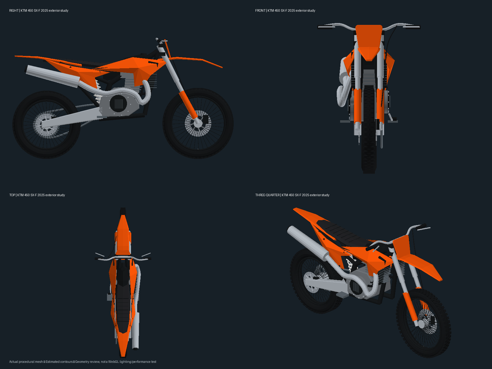

# KTM 450 SX-F 2025 review build

Scope: finish the existing KTM experience. This pass improves the original mesh and viewer. It does not meet the accurate-HD visual acceptance requirement; contours and mount coordinates are still estimated.

## Changes

- Non-planar molded shrouds, side panels and airbox covers, with closed thickness and outward faces.
- Tapered rounded number plate aligned to the fork rake, asymmetric engine covers, water-pump exterior and shift lever.
- Drilled brake discs, catalog-supported black spokes, fuel-tank exterior and cap, narrower radiators, revised exhaust route and muffler proportions.
- Retained separate plastics meshes, material channels, stock restoration and generic accessory labels.
- Low-angle orbit, floor shadows, reduced light intensity, supported Three shadow mode and explicit shadow-resource cleanup.
- Reproducible four-view CPU geometry renderer. This checks geometry only; it does not validate browser lighting, gestures or frame rate.

## Review fixes

Fresh independent review identified a gap between the retained stock header and replacement slip-on, and inverted panel triangles at the supported seat-height minimum. Both received failing regression tests before correction. The slip-on now has an inlet connector whose world-space endpoint matches the header outlet. Body panels deform with a common affine transform so cap winding remains valid at both dimension limits. Also fixed the deprecated shadow constant and shadow disposal.

The previous deferred sprocket-test weakness is addressed: raycasts pass through the center and cut-out, and hit the solid annulus. Panel exterior normals are checked.

## Where to open

- Web authoring preview: `/bike-builder.html` on a build of this branch; `npm run dev` locally.
- Garage: set `VITE_BIKE_BUILDER_PREVIEW=true` for the web build and select the exact standard-US 2025 KTM 450 SX-F.
- iPhone development build: `EXPO_PUBLIC_BIKE_BUILDER_PREVIEW=true`; regenerated offline viewer is checked into `apps/mobile/src/generated/bike-preview.json`.
- `npm run build:bike-native` also creates `artifacts/bike-builder/offline-preview.html`, a standalone viewer for a desktop browser, with no external requests.
- `node --experimental-strip-types scripts/export-bike-blockout.mjs` regenerates the editable GLB.
- `node --experimental-strip-types scripts/render-bike-review.mjs | python scripts/render-bike-review.py artifacts/bike-builder/ktm-review.png` regenerates the contact sheet (Python requires NumPy and Pillow).

## Readiness

Final validation: 232/232 root tests, web typecheck/production build, 12/12 mobile tests and typecheck, native viewer freshness, and successful iOS/Android Expo exports. No critical or important review findings remain unaddressed; both important findings were reproduced and fixed, and both minor shadow findings were fixed.

Stock export: 1,766,168 bytes, 63 mesh objects, 47,578 rendered triangles; GLB validator reports zero errors and warnings. The validator does not support GPU-instancing validation. Native offline HTML is approximately 730 KB. Shadow rendering adds GPU work and requires physical-device performance checks.

Unverified: real iPhone gestures/restart/performance, rendered WebGL appearance, and exact OEM likeness. Four-view CPU inspection is complete; Kyle's visual approval is outstanding. Feature remains behind the existing development flags. No production deployment or merge.

Ruling: preserve the existing estimated-geometry designation until the visual acceptance criterion is met. Cost: this is a runnable review build, not a completed HD production model.
